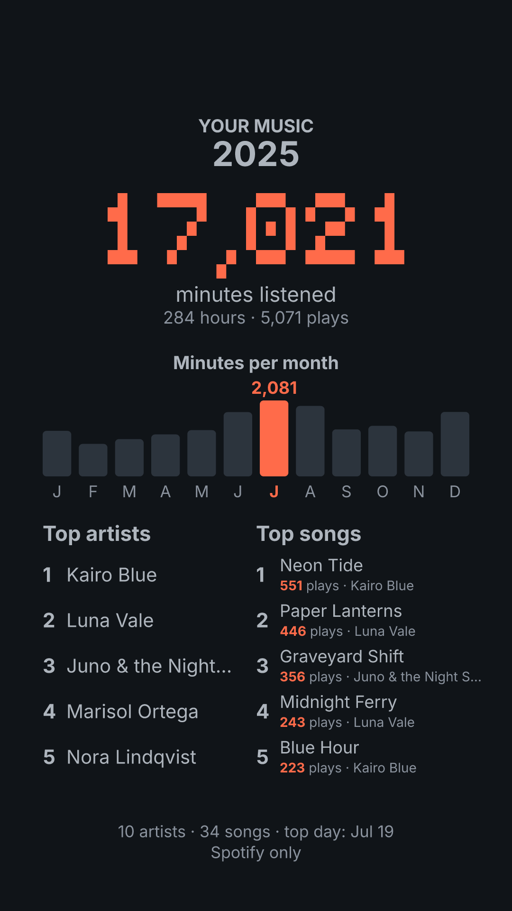
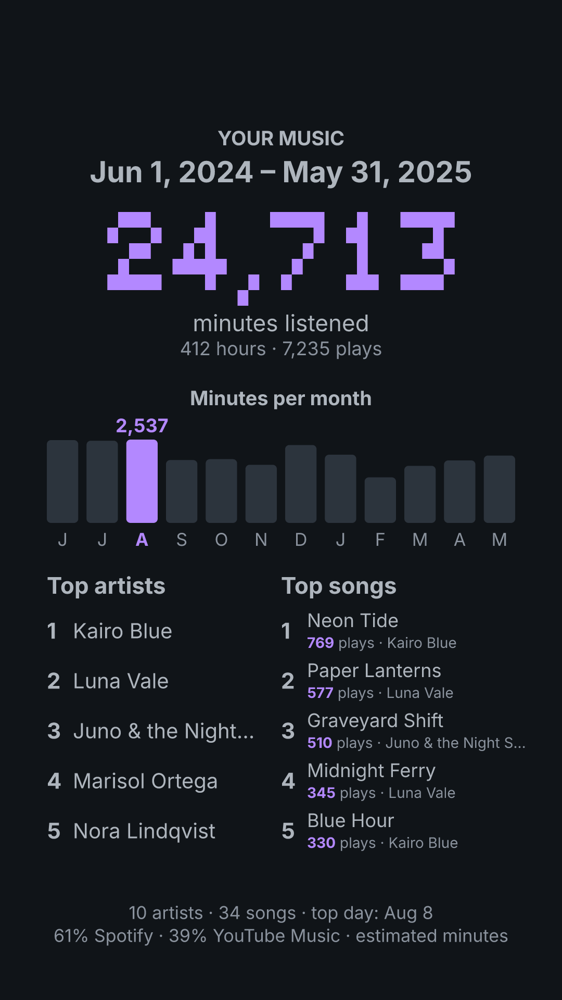
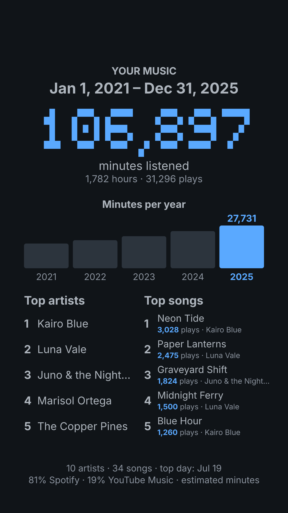
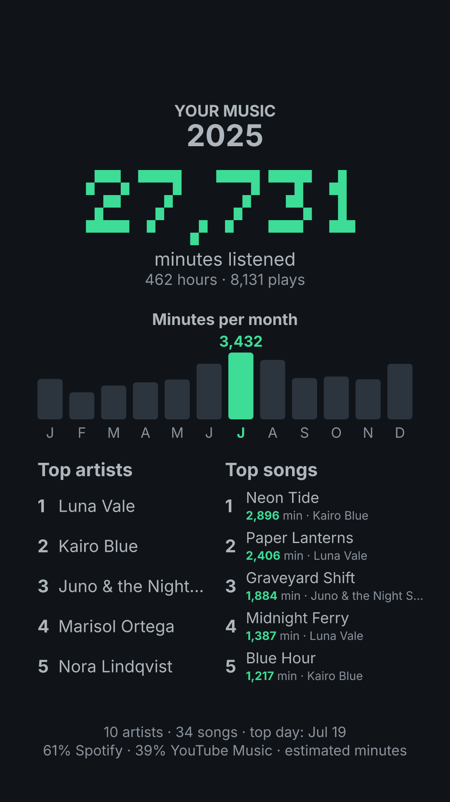

# mw — Music Wrapped

Your own "Wrapped" from your Spotify and YouTube Music data: total minutes, minutes per month, top artists and top songs, for any date range you want. It creates a 1080×1920 vertical image ready to share from your phone.

Everything runs locally: your data never leaves your computer. The only download is the shared [song database](data/README.md) (no data of yours is sent); `--offline` skips it.

- [Samples](#samples)
- [Installation](#installation)
- [Prerequisites](#prerequisites)
- [Running](#running)
- [How it counts](#how-it-counts)
- [Development](#development)
- [Credits](#credits)

## Samples

Made from a fictional listening history (2021–2025; YouTube Music from 2024).

<p>
  <a href="docs/samples/year.png"></a>
  <a href="docs/samples/range.png"></a>
  <a href="docs/samples/history.png"></a>
  <a href="docs/samples/minutes.png"></a>
</p>

1. One year, Spotify only: `--year 2025 --source spotify`
2. Custom range, both sources (estimated minutes): `--from 2024-06-01 --to 2025-05-31 --color purple`
3. Whole history; past 24 months the chart goes by year: `--color blue`
4. Top lists by minutes: `--year 2025 --rank-by minutes --color green`

## Installation

Download the latest release into the current directory:

```bash
# Linux and macOS
curl -fsSL https://raw.githubusercontent.com/lulivi/mw/main/scripts/install.sh | bash
```

```powershell
# Windows (PowerShell)
irm https://raw.githubusercontent.com/lulivi/mw/main/scripts/install.ps1 | iex
```

They check the download against its checksum and overwrite any `mw` already there. Or pick the prebuilt binary yourself:

- macOS (Apple Silicon): [mw-aarch64-apple-darwin.tar.gz](https://github.com/lulivi/mw/releases/latest/download/mw-aarch64-apple-darwin.tar.gz)
- macOS (Intel): [mw-x86_64-apple-darwin.tar.gz](https://github.com/lulivi/mw/releases/latest/download/mw-x86_64-apple-darwin.tar.gz)
- Windows (x64): [mw-x86_64-pc-windows-gnu.zip](https://github.com/lulivi/mw/releases/latest/download/mw-x86_64-pc-windows-gnu.zip)
- Linux (x64, static): [mw-x86_64-unknown-linux-musl.tar.gz](https://github.com/lulivi/mw/releases/latest/download/mw-x86_64-unknown-linux-musl.tar.gz)
- Linux (arm64, static): [mw-aarch64-unknown-linux-musl.tar.gz](https://github.com/lulivi/mw/releases/latest/download/mw-aarch64-unknown-linux-musl.tar.gz)

Extract it to get `mw` (`mw.exe` on Windows); each archive has a `.sha256` next to it. The binaries aren't signed: on macOS, run `xattr -d com.apple.quarantine mw` once if it refuses to open.

With Rust installed, you can instead run `cargo install --git https://github.com/lulivi/mw`.

## Prerequisites

### Spotify

1. Open spotify.com/account/privacy in a browser (a phone browser works too).
2. Under "Download your data", tick **Extended streaming history** and click "Request".
3. Confirm the request from the email Spotify sends you. The ZIP can take up to 30 days.
4. Unzip it: inside there are `Streaming_History_Audio_*.json` files.

The basic history ("Account data", `StreamingHistory_music_*.json`) also works, but it only covers the last year.

### YouTube Music

1. On takeout.google.com, click "Deselect all" and tick only **YouTube and YouTube Music**.
2. Under "All YouTube data included", keep only **history**.
3. Under "Multiple formats", change history from HTML to **JSON**.
4. From the ZIP, take `Takeout/YouTube and YouTube Music/history/watch-history.json`.

## Running

```bash
# 2025 with both sources combined
./mw --spotify ./my_data/spotify --ytm ./my_data/watch-history.json --year 2025

# A custom range, Spotify only, terminal only
./mw --spotify ./my_data/spotify --from 2024-06-01 --to 2025-05-31 --source spotify --no-image

# Your whole history (no dates)
./mw --spotify ./my_data/spotify --ytm ./my_data/watch-history.json
```

On Windows use `mw.exe`; after `cargo install`, just `mw`. Run `mw --help` for every option.

## How it counts

- Spotify plays shorter than 30 seconds don't count (they're skips), same as the official Wrapped. Podcasts and audiobooks are ignored.
- YouTube Music doesn't record how long you listened to each song, only that you played it. Each play counts `--ytm-avg-minutes` minutes, which is why the total is marked as estimated when YouTube Music is included ("≈" in the terminal, "estimated minutes" in the image).
- Songs in the [song database](data/README.md) count their song length instead, assuming you listened to the whole song. A play is matched by video ID (then the database names replace the Takeout ones, which carry wording like "Watched" in your account language) or else by artist and title. `mw` keeps a copy of the database in your cache folder and, on every run, downloads it again only if it changed: with no connection it uses that copy, and with no copy every play keeps the estimate. `--offline` uses only the copy; `--db <URL|PATH>` reads another database.
- Artists and songs are merged across sources ignoring case, accents and YouTube add-ons like " - Topic" or "(Official Video)".

## Sharing song lengths

YouTube Music doesn't say how long a song is, so `mw` looks it up in the shared
[song database](data/README.md). You can help fill it. Nothing about what you
listened to or when leaves your computer: only artists, titles and lengths.

**If you use Spotify**, share the lengths of the songs you played to the end:

```bash
./mw db export-spotify --spotify ./my_data/spotify
```

**If you use YouTube Music**, share the songs the database is missing:

```bash
./mw db export-ytm --ytm ./my_data/watch-history.json
```

Each one writes a file (`spotify-durations-….json` or `ytm-missing-….json`)
with only the songs the database doesn't have yet. Send it to the maintainer;
there's nothing to edit. Spotify needs the Extended streaming history.

How the files are checked and added: [docs/reviewing-contributions.md](docs/reviewing-contributions.md).

## Development

```bash
cargo build --release              # target/release/mw
cargo run --release -- --help      # build and run with arguments
./scripts/test.sh                  # cargo test
./scripts/lint.sh                  # cargo fmt --check + clippy + shellcheck, as CI runs them
./scripts/samples.sh               # regenerate docs/samples/ after changing the image
./scripts/dist.sh                  # cross-compile the release archives into dist/ (needs Docker)
```

Layout: `src/sources/` (one reader per service) → `model.rs` (`Play`) → `stats.rs` (filters and aggregates) → `render.rs` (SVG → PNG with resvg). `songdb.rs` loads the song database and applies its lengths, `lengths.rs` measures song lengths from Spotify full plays and defines the contribution file, `musicbrainz.rs` looks up song lengths for `mw db resolve`, and `normalize.rs` builds the keys that merge artists and songs. The fonts are embedded in the binary so the image looks the same everywhere.

## Credits

- [Inter](https://github.com/rsms/inter) (Regular and Bold), Copyright (c) 2016 The Inter Project Authors, SIL Open Font License 1.1: `assets/OFL-Inter.txt`.
- [Tiny5 Mono](https://github.com/Gissio/font_Tiny5Mono) Regular, for the main figure, SIL Open Font License 1.1: `assets/OFL-Tiny5Mono.txt`.
